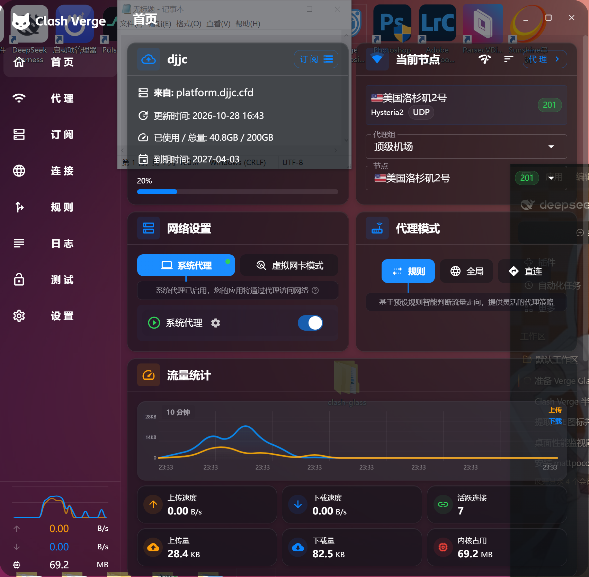
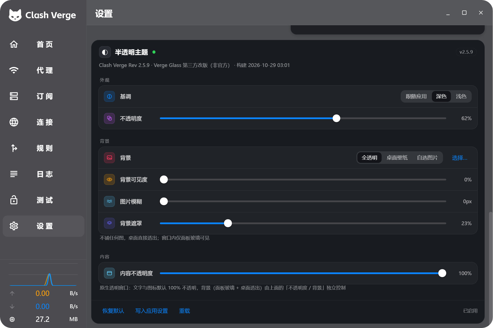
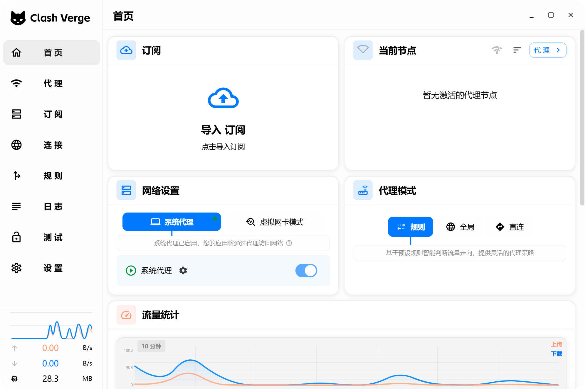

# Verge Glass · Clash Verge Rev 半透明主题插件

为 **Clash Verge Rev 2.5.x**（Windows / WebView2）做的半透明主题插件。

- **1.9.0 起有两个形态**：① 插件形态（原版 App + CDP 注入，整窗 alpha 近似）；② **分支形态**（[Clash Verge Rev 源码分支](./docs/FORK.md) + 原生透明窗口，背景透明与内容不透明度彻底独立）。分支形态见 `docs/FORK.md`；
- 不改动 Clash Verge 的任何源码、二进制或核心网络组件（分支形态只改窗口创建参数）；
- 通过 WebView2 调试协议（CDP）在运行时注入一套 **iOS 风玻璃主题** + 一个 **设置页内嵌卡片**；
- 卡片常驻：**关掉「启用」只会还原主题，不会移除卡片和开关**；
- 背景支持 **全透明 / 桌面壁纸 / 自选图片**，并提供可见度、模糊、遮罩三档调节；
- 保留原版的圆角矩形布局与信息层级，只替换「材质」：发丝线、圆角分组、毛玻璃、层级模糊；
- 数字统一 `tabular-nums` 等宽对齐，折线图容器统一圆角内描边。







---

## 1. 能力边界（先说清楚）

| 需求 | 能否做到 | 说明 |
| --- | --- | --- |
| 半透明（背景从面板透出来） | ✅ | 壁纸层 + `backdrop-filter` 毛玻璃 + 半透明面板 |
| 可调黑/白主题 | ✅ | 面板「基调」，同时联动 App 的 `theme_mode`，避免文字对比度错乱 |
| 可调透明度 | ✅ | 面板不透明度 5%–95%，实时生效 |
| 背景全透明 / 导入图片 | ✅ | 三种背景来源 + 可见度 / 模糊 / 遮罩 |
| 内建在设置页 | ✅ | 运行时挂进「设置」页卡片网格，路由切换自动挂载 |
| 开关关闭后保留面板 | ✅ | 只移除主题样式，卡片与开关留在原地 |
| 不修改源程序 | ✅ | 只注入 DOM/CSS，不写安装目录、不碰 exe、不碰 mihomo 内核 |
| 真·窗口透明（看到后面的其他程序） | ✅ | 「窗口透视」：`WS_EX_LAYERED` + 整窗 alpha（5%–100%），标题栏同步透明 |
| 只让背景透明、UI 完全不透明 | ❌ | WebView2 的窗口合成表面是不透明的，外部只能做「整窗 alpha」；要「UI 完全不透明」请用「桌面壁纸 / 自选图片」背景模式 |

**关于「只让背景透明」**：实测过三种外部方案都不成立 ——
`LWA_COLORKEY` 色键（WebView2 的 DirectComposition 表面不吃色键）、
CDP `Emulation.setDefaultBackgroundColorOverride` + 页面全透明（窗口背景刷仍是不透明色）、
以及逐元素 alpha（窗口 alpha 是整窗的）。
所以插件在开启「窗口透视」时会给文字加一层描边阴影，尽量保证低 alpha 下依然可读；
真正「UI 完全不透明 + 背景透出」请用「桌面壁纸 / 自选图片」模式（背景图 + 不透明 UI）。

**为什么用「整窗 alpha」而不是「只让背景透明」**：

- WebView2 的合成表面是不透明的（Tauri 建窗时 `Color(46, 48, 61, 255)`），页面侧无法把「背景」单独挖透明；
- 但窗口本身可以通过 `WS_EX_LAYERED + SetLayeredWindowAttributes(LWA_ALPHA)` 做整窗 alpha —— 这是外部进程可以合法完成的；
- 代价：整窗（含文字、图标）一起变半透明。0.85–0.92 之间文字仍然清晰，再低就会发虚；
- 标题栏用 `DwmExtendFrameIntoClientArea(0,0,40,0)` + `ACCENT_ENABLE_BLURBEHIND` 做成同款玻璃，与窗口一起透视。
---

## 2. 视觉设计（v1.2）

- **材质**：所有面板 = 半透明底色 + `backdrop-filter` 模糊 + 1px 发丝线；
- **圆角**：沿用原版圆角矩形，统一为 8 / 11 / 14 / 18px 四档；
- **层级**：侧栏 > 卡片 > 分组 > 行，靠「模糊强度 + 透明度 + 发丝线」区分，不靠颜色堆叠；
- **表单**：iOS 风开关、滑杆、分段控件、文本按钮；
- **数字**：`font-variant-numeric: tabular-nums`，字重 600–650，速度/流量跳动时不抖；
- **图表**：折线图容器统一圆角内描边，和卡片同一语言（画布本身由 App 绘制，只调容器）；
- **面板图标**：每行一枚 iOS 风格彩色圆角小方块（启用绿 / 基调蓝 / 不透明度紫 / 毛玻璃青 …）；
- **侧栏**：选中项改为胶囊指示器，切换页面时带 0.26s 缓动滑动；
- **状态色语义**：延迟、支持/不支持/待检测等 Chip 按语义色给半透明底 + 同色描边（绿/橙/红/蓝）；
- **一致性修正**：
  - 顶栏与页面标题栏去线、同底色（首页/设置等所有页面）；
  - 所有选项卡（选中/未选中）圆角统一 10px；分段按钮组加 3px 内边距 + 4px 间隙；
  - 开关轨道半透明（62% 主色 / 22% 发丝色）；
  - 连接页表格（App 内联样式写死的不透明底色）通过属性选择器玻璃化；
  - 「全透明」模式会把背景图与遮罩一起去掉。

---

## 3. 安装

要求：Windows 10/11、Clash Verge Rev 2.5.x、PowerShell 5.1+。

**最简单**：把整个文件夹复制到任意位置（U 盘也行），双击 **`Install.cmd`** 即可。

> 也提供了单文件 **`VergeGlass-Setup.exe`**（内嵌全部文件，双击即装；`/uninstall` 卸载，`/quiet` 静默）。
> 注意：部分安全软件（360/Defender 等）会拦截未签名的 exe 写 `%LOCALAPPDATA%`，
> 这种情况下 exe 会提示失败，请改用 `Install.cmd`（功能完全一致）。

也可以命令行：

```powershell
cd D:\Tools\verge-glass
powershell -ExecutionPolicy Bypass -File .\Install.ps1
# 或者直接调用引擎
powershell -ExecutionPolicy Bypass -File .\VergeGlass.ps1 install
```

安装器会（一步完成）：

1. 复制运行文件到 `%LOCALAPPDATA%\VergeGlass\`；
2. 注册登录自启 `HKCU\...\Run\VergeGlass` → `wscript.exe //B VergeGlass.vbs`（隐藏窗口启动）；
3. 创建开始菜单快捷方式 **Clash Verge (Verge Glass)**；
4. 关闭 Clash Verge 自带「开机自启」（避免它先启动导致调试端口不可用）；
5. 用 `--remote-debugging-port=9333` 启动 App，并拉起守护进程；
   **并把主题写进 App 的 `theme_setting.css_injection`** —— 一次注入，之后重启 App 也生效（不依赖守护进程）；
6. **注入交给守护进程完成**（安装器不再自己连 CDP，流程只剩「启动 App + 守护进程」两步）；
   守护进程会一直等待窗口出现（App 静默启动 / 轻量模式也不会放弃）。

常用开关（传给 `Install.ps1` 或 `VergeGlass.ps1 install`）：

```powershell
-NoAutostart          # 不注册登录自启
-KeepAppAutoLaunch    # 保留 App 自带自启
-WriteCssInjection    # 同时把主题写进 App 的「CSS 注入」，不走插件也生效
-UpdateUrl <url>      # 指定插件更新源
```

卸载：双击 **`Uninstall.cmd`**（或 `VergeGlass.ps1 uninstall`）。

> 登录自启后请从 **Clash Verge (Verge Glass)** 启动，或重启电脑。

---

## 4. 使用

App → **设置** → 页面最底部 **「半透明主题」** 卡片。

### 窗口（真透明）

| 控件 | 作用 |
| --- | --- |
| 窗口透视 | 开关；打开后整个窗口（含标题栏）按 alpha 与桌面混合，能真正看到后面的程序 |
| 窗口不透明度 | **5%–100%**（5% 几乎全透明，100% 完全不透明），建议 85%–92% |

> 打开「窗口透视」时插件会自动把「背景」切到「全透明」，避免背景图把桌面盖住；关闭时恢复原来的背景选择。

### 外观

| 控件 | 作用 |
| --- | --- |
| 启用 | 关掉只还原主题，**卡片和开关保留**，可随时再打开 |
| 基调 | 跟随应用 / 深色 / 浅色（选后两者会同步 App 的 `theme_mode`） |
| 不透明度 | 面板底色 alpha，**0%–100%**（0% 完全透明，100% 完全不透明） |

| 毛玻璃 | `backdrop-filter` 模糊，0–48px |

### 背景

| 控件 | 作用 |
| --- | --- |
| 背景 | 全透明 / 桌面壁纸（自动读取当前壁纸）/ 自选图片 |
| 选择… | 导入本地图片（自动缩放到 2560px，JPEG 存 localStorage） |
| 背景可见度 | 背景层整体不透明度 |
| 背景模糊 | 背景层自身模糊（0–40px） |
| 背景遮罩 | 压暗/提亮遮罩强度（0–100%），用来保证任何背景上的可读性 |

### 底部

- **恢复默认**：回到 62% / 24px / 桌面壁纸 / 28% 遮罩；
- **写入应用设置**：把当前主题写进官方 `设置 → Verge 设置 → 主题 → CSS 注入`，不经过插件也生效；
- **重载**：重新应用一次样式（改过 CSS 文件后可用）。

设置保存在 WebView2 的 `localStorage`（键 `verge-glass:v2`），只有点「写入应用设置」才会写 App 配置。

---

## 5. 与发布页同步更新

### 5.1 兼容性自检

```powershell
powershell -ExecutionPolicy Bypass -File .\VergeGlass.ps1 check
```

1. 读本地 `clash-verge.exe` 版本；
2. 调 GitHub `releases/latest` 比对最新 tag；
3. CDP 探针检查主题依赖的 DOM 钩子：

| 探针 | 选择器 | 用途 |
| --- | --- | --- |
| layout-root | `.MuiPaper-root.windows.layout` | 主窗口底色 |
| sidebar | `.layout-content__left` | 侧栏玻璃 |
| content | `.the-content` | 内容区 |
| base-container | `.base-container` | 内容面板 |
| settings-grid | `.the-content .base-content .MuiGrid-container` | 设置卡片挂载点 |
| menu | `ul.the-menu` | 路由与菜单 |

输出示例（2.5.8 实测）：

```
installed app      : 2.5.8
latest release     : v2.5.8  (2026-10-09T02:43:45Z)
=> app is up to date
selector probes    : all OK - the theme can be applied to this build
```

### 5.2 插件自更新

`plugin.json` 描述版本与文件：

```json
{
  "name": "verge-glass",
  "version": "1.1.2",
  "appSupported": ">=2.4.0 <2.7.0",
  "entry": "src/verge-glass.js",
  "style": "src/verge-glass.css",
  "files": {
    "src/verge-glass.css": "src/verge-glass.css",
    "src/verge-glass.js": "src/verge-glass.js"
  }
}
```

`files` 支持相对清单地址的路径或完整 URL。`update` 会：拉清单 → 比版本 → 下载 → 备份旧文件到
`%LOCALAPPDATA%\VergeGlass\backup\` → 写回清单；守护进程检测到版本变化后**热重载**（重新注册注入脚本 + 刷新页面）。

```powershell
... install -UpdateUrl "https://raw.githubusercontent.com/<owner>/<repo>/main/plugin.json"
... update  -UpdateUrl "https://raw.githubusercontent.com/<owner>/<repo>/main/plugin.json"
```

发布流程：建仓 → 推 `VergeGlass.ps1` / `plugin.json` / `src/` → 改版本号提交（可选打 Release）→ 用户执行 `update`。

### 5.3 App 大改版

主题只依赖三样相对稳定的东西：

1. 官方出口 `theme_setting.css_injection`；
2. 布局类名（`.layout-content__left` / `.the-content` / `.base-container` / `.MuiGrid-container`）；
3. App 自己在 `<html style="--background-color: …">` 上维护的主题色变量。

升级流程：`check` → 探针全过则无需操作；有 `MISSING` 时只改 `src\verge-glass.css` 对应选择器 →
升 `plugin.json` 版本 → 推仓库 → 用户 `update` 热更新。**不需要重新编译 App**。

### 5.4 不装插件的纯 CSS 模式

把 `src\verge-glass.css` 贴进 **设置 → Verge 设置 → 主题 → CSS 注入**，改文件顶部变量即可：

```css
:root {
  --vg-base: 16, 18, 24;      /* 深色；浅色 255,255,255 */
  --vg-alpha: 0.62;           /* 面板透明度 */
  --vg-blur: 24px;            /* 毛玻璃 */
  --vg-wallpaper: url("http://asset.localhost/<编码后的图片路径>");
  --vg-wall-opacity: 0.85;
  --vg-veil: 0.28;            /* 遮罩强度 */
}
```

---

## 6. 卸载

```powershell
powershell -ExecutionPolicy Bypass -File .\VergeGlass.ps1 uninstall
```

移除登录自启、开始菜单快捷方式、`%LOCALAPPDATA%\VergeGlass`，必要时恢复 App 开机自启。
点过「写入应用设置」的，还需到 App 的 `主题 → CSS 注入` 手动清空一次。

---

## 7. 目录结构

```
verge-glass/
├─ Install.cmd              一键安装（双击）
├─ Install.ps1              安装器脚本（可复制到任意目录使用）
├─ Uninstall.cmd            一键卸载
├─ assets\clash-verge.ico   主题配色的图标（开始菜单快捷方式 / exe 都用它）
├─ VergeGlass.ps1           主程序：install / start / apply / status / check / update / uninstall
├─ plugin.json              清单（版本、更新文件、兼容范围）
├─ src/
│  ├─ verge-glass.css       主题（变量区可直接手改）
│  └─ verge-glass.js        注入脚本：主题 + 设置卡片 + 持久化
├─ docs/                    截图
└─ tools/                   开发调试脚本（CDP 客户端、截图、探针），运行插件不需要
```

---

## 8. 原理

```
VergeGlass.vbs → VergeGlass.ps1 start
   ├─ 启动 clash-verge.exe，环境变量 WEBVIEW2_ADDITIONAL_BROWSER_ARGUMENTS=--remote-debugging-port=9333
   ├─ GET http://127.0.0.1:9333/json/list → 取 WebView2 页面 target
   ├─ CDP: Page.addScriptToEvaluateOnNewDocument(注入源码) + Runtime.evaluate(立即执行)
   └─ 守护循环：App 重启 / 页面刷新 / 插件版本变化 → 重新注入

注入源码 = window.__VG_HOST__ = { version, appVersion, css, wallpaper } + verge-glass.js
   ├─ 插入 <style id="verge-glass">
   ├─ 在 <html> 写 --vg-* 变量、data-vg-tone、data-vg-bg
   └─ 设置页网格里挂载设置卡片
```

需要持久化时才调用 App 自己的 IPC：`get_verge_config` / `patch_verge_config`（正常前端调用，不是私有接口）。
端口只监听 `127.0.0.1`，进程退出即释放。

---

## 9. FAQ

**面板没出现？** 确认是从「Clash Verge (Verge Glass)」启动；`VergeGlass.ps1 status` 看 `CDP reachable`；
设置页要拉到最底部。

**主题没生效？** `status` 看 `selector probes`；点了卡片里的「重载」；检查是否被 `-WriteCssInjection` 写过之后又手动清空。

**标题栏还是系统色？** 原生标题栏由 App 控制（`decorations(true)`），插件只处理 WebView 内容区；切「基调」时 App 会同步 `theme_mode`。

**动态壁纸？** 插件读注册表静态壁纸（`HKCU\Control Panel\Desktop\Wallpaper` 或 `TranscodedWallpaper`）；
Wallpaper Engine 取不到，用「自选图片」导入一张即可。

**性能？** `backdrop-filter` 只加在侧栏 / 卡片 / 弹层；滑杆实时预览时才有连续合成。

**安全？** CDP 只绑 `127.0.0.1`，只在插件拉起的进程里开启；介意就用 5.4 的纯 CSS 模式。

---

## 10. 版本记录

| 版本 | 变更 |
| --- | --- |
| 1.13.0 | 移除「背景模糊」整行（功能 / 位置 / 实验性标签 / 说明）——它只能模糊页面内的背景层，透着桌面时永远没效果；只保留能用、看得见的「图片模糊」。面板玻璃的模糊沿用上次保存的 `blur` 值，不再暴露滑杆。分支打包改为单文件 `VergeGlass-Setup.exe`（glass 图标、简体中文安装界面、版本信息里注明第三方改版）；主题卡片副标题显示「Verge Glass 第三方改版（非官方）· 构建 <时间>」 |
| 1.12.1 | 修「关掉窗口再打开又出现外框」：`DWMNCRP_DISABLED` 关掉 DWM 的非客户区渲染（那圈 12px NC 被窗口类画刷涂白就是外框），守护线程增加「隐藏→可见」检测并跑完整修复阶梯；区域去掉多圈进去的 1px NC 像素（右/下边的 1px 白线）并把校验改成精确相等；「背景模糊」在全透明背景时置灰并说明它模糊不到桌面 |
| 1.12.0 | 修「选自选图片时四角出方块」（壁纸层 `scale(1.025)` 把自身圆角推出窗口，改为根元素 `clip-path: inset(0 round 26px)` 统一裁切）；修「浅色模式半透明失效」（不透明宿主时代的 0.97 白纱只保留给非原生宿主）；「毛玻璃」更名「背景模糊」并标注实验性，原来的背景模糊更名「图片模糊」；模糊不再强制 ≥8px |
| 1.11.1 | 主题常开：移除设置卡里的「启用」开关与关闭态逻辑，不再提供关闭主题的入口 |
| 1.11.0 | 主题内置进程序（include_str! + initialization_script，不再依赖 CDP 守护进程/独立快捷方式）；Windows 启用自定义缩放手柄；图标换成 glass 版；窗口区域裁剪去掉 NC 白边 |
| 1.10.8–1.10.9 | 去掉最外圈框线（outline: 0）；窗口按钮改为 36×28 并整体右移；焦点切换/窗口重叠时用 RedrawWindow + DwmFlush 冲掉 DWM 旧帧（灰标题栏消失），并撤掉 SetWindowRgn（它会在遮挡/重露时残留像素） |
| 1.10.5–1.10.7 | 外框线改用 outline（不挤布局、跟圆角）；窗口外壳加了 1.5s 守护线程（重叠/最小化/换屏后自动修回 caption/frame/region）；三个圆点悬停放大 1.18×、透出图标并在下方浮出「最小化/最大化/关闭」标签 |
| 1.10.0–1.10.4 | 窗口按钮改为 macOS 三色圆点（去掉外框、间距 11px）；首页右上角快捷入口隐藏；SetWindowRgn 裁圆角 + 去掉 WS_CAPTION/WS_THICKFRAME（修掉外框线与锯齿）；新增 erify-window.ps1 原生侧护栏 |
| 1.9.6–1.9.9 | 标题条并入页面头部：窗口按钮不再单独占一行，浮在头部行右上角；头部承载整条玻璃；按钮与「帮助/代理/GitHub」错开；probe-chrome.js 增加「不重叠」断言 |
| 1.9.5 | 圆角加大到 26px；去掉窗口边框线；遮罩/壁纸层跟窗口同圆角（四角不再出现方形半透明块）；probe-chrome.js 增加圆角与遮罩半径断言 |
| 1.9.4 | 修复「顶栏中间横线 + 上下透明度不一致」：自绘标题栏与应用顶栏合并为一层玻璃（同一 --vg-chrome-bg，去掉中间边框），窗口圆角 14px + 1px 发丝线；新增 	ools\probe-chrome.js 回归探针 |
| 1.9.3 | 顶栏恢复玻璃并跟随「不透明度」；首页提示条（#2E303D 底色）纳入玻璃化（中性色阈值 g−b < 16） |
| 1.9.2 | 原生模式把明显不可用的旧值（面板 α<15% / 遮罩<15% / 模糊<8px）自动抬回可读区间；分支 NSIS 安装包落地验证 |
| 1.9.1 | 原生透明模式下保留背景遮罩（可读性）；旧「窗口透视」下被拉到 0 的面板/遮罩一次性迁移到可读默认值（α 0.62 / 模糊 22 / 遮罩 0.32） |
| 1.9.0 | **分支版**：宿主改用原生透明窗口（`transparent` + WebView2 背景 α=0），整窗 alpha 与内容彻底解耦；「窗口透视」退役，新增「内容不透明度」；Windows 改无边框自绘标题栏；停用应用自更新（内核更新不受影响） |
| 1.8.6 | 护眼模式背景层饱和度 0.45 / 0.40，底色更接近纯米色 |
| 1.8.5 | 护眼白定为「米黄底 + 深棕字」：底纱 rgba(244,230,203,0.88)，面板 #FDF5E5，正文 #2C2213，发丝线加深；护眼黑保持不变 |
| 1.8.3 | 护眼模式提高辨识度：文字提亮、按钮/标签加粗、选中态加重；顶栏一并纳入暖化，与内容区同色 |
| 1.8.2 | 护眼模式把蓝/绿/红等彩色元素统一压成不同亮度的米色（sepia 0.78 / 0.70） |
| 1.8.0 | 新增护眼配色「护眼黑 / 护眼白」（米黄+棕色系，菜单/文字/按钮/分隔线整体调色）；常规浅色背景薄纱提到 0.90 且不再用 brightness 提亮 |
| 1.7.3 | 浅色模式背景薄纱 0.66 → 0.84（上限 0.96），背景不再发灰偏深；深色模式未改动 |
| 1.7.0 | 新图标（蓝紫主题配色）用于开始菜单入口与 exe；安装改为只复制变化的文件、主题写入交给守护进程（不再阻塞安装）；卸载会先停守护进程、恢复 Clash Verge 自启并在有备份时还原原 css_injection |
| 1.6.8 | 暂时移除「深色壁纸 / 浅色壁纸」系数，背景不透明度回到只由「背景可见度」控制 |
| 1.6.7 | 两个系数改回只作用于「壁纸层不透明度」（乘在背景可见度上，浅深色独立），不再影响面板不透明度 |
| 1.6.6 | 背景系数改为两个独立可调项，不再互相按比例推导 |
| 1.6.5 | 整体背景再降透明度：深色模式在滑杆值上 ×0.85（-15%），浅色模式 ×0.92（-8%）；注入方式与 `css_injection` 长效方案不变 |
| 1.6.4 | 打包单文件 `VergeGlass-Setup.exe`；安装默认把主题写进 `css_injection`（一次注入长期有效） |
| 1.6.3 | 图表底部小字改为常驻扫描，避免数据刷新后不再隐藏 |
| 1.6.2 | 浅色模式背景自动提亮（brightness + 白纱），不再出现「浅色主题配深色背景」；窗口透视时给文字加描边阴影提升可读性 |
| 1.6.1 | 守护进程改为「等窗口出现」而不是直接退出，静默/轻量启动也能注入 |
| 1.6.0 | 一键安装器 Install.cmd / Install.ps1 / Uninstall.cmd；安装流程简化为「复制 + 启动守护进程」；不透明度 0%–100%、窗口不透明度 5%–100% |
| 1.5.6 | 去掉标题栏 accent 模糊（它会在窗口外沿扩散出一圈半透明光晕），标题栏保持透明 |
| 1.5.5 | 隐藏图表底部小字（数据点 / 压缩后 / 帧率 / 平滑）；侧栏胶囊底色降到 6%，与下方内容同调 |
| 1.5.4 | 侧栏胶囊改为按下即动，并修复菜单重渲染后事件丢失 |
| 1.5.2 | 开关行只保留一层极淡底色，去掉双层圆角框 |
| 1.5.0 | 去掉窗口本体外框与四角圆角线；选项卡去掉描边/outline；标题栏玻璃更透 |
| 1.4.1 | 选项卡状态点：仅选中项显示、统一绿色；选项卡描边统一；日志行固定 50px 消除文字重叠 |
| 1.4.0 | 撤销过紧的列表间距覆盖，恢复设置页原生行高与留白 |
| 1.3.3 | 不透明面扫描降频 + 上限保护，长列表页面更省 CPU |
| 1.3.2 | 标题栏玻璃化与窗口透视联动；不透明面扫描节流；图表画布提亮 |
| 1.3.0 | 新增「窗口透视」真透明（整窗 alpha + 玻璃标题栏）；新增不透明面归一化（订阅卡片、说明条等自动玻璃化）；图表容器加深、画布提亮；统一模块间距 |
| 1.2.1 | 开关轨道减淡；分段按钮组间隙加大；浅色语义色微调 |
| 1.2.0 | 视觉一致性修正：顶栏去线、选项卡/分段圆角统一、状态 Chip 半透明语义色（延迟/支持/待检测）、开关轨道半透明、连接页表格玻璃化、全透明模式去遮罩；新增面板行内彩色图标、侧栏胶囊滑动动效 |
| 1.1.2 | 内容层改为完全透明，卡片直接浮在背景上；遮罩默认 28% |
| 1.1.1 | 面板行高/间距收紧；顶栏玻璃加强 |
| 1.1.0 | iOS 风重做：发丝线 + 圆角分组 + 开关/滑杆/分段控件；关闭时保留面板；背景三模式（全透明/壁纸/图片）+ 可见度/模糊/遮罩；数字等宽、图表容器圆角描边 |
| 1.0.0 | 首个版本：CDP 注入、设置页卡片、深浅主题、透明度、更新机制 |

## 11. 兼容性

| Clash Verge Rev | 结果 | 备注 |
| --- | --- | --- |
| 2.5.8 | ✅ 实测 | 探针全过；深浅 / 透明 / 壁纸 / 开关保留 / 持久化 / 热更新均验证 |
| 2.4.x – 2.6.x | ⚠️ 预期可用 | 布局与 MUI 类名一致，未逐版实测 |
| 3.x | ❌ 未验证 | 先跑 `check`，按 5.3 调整选择器 |
